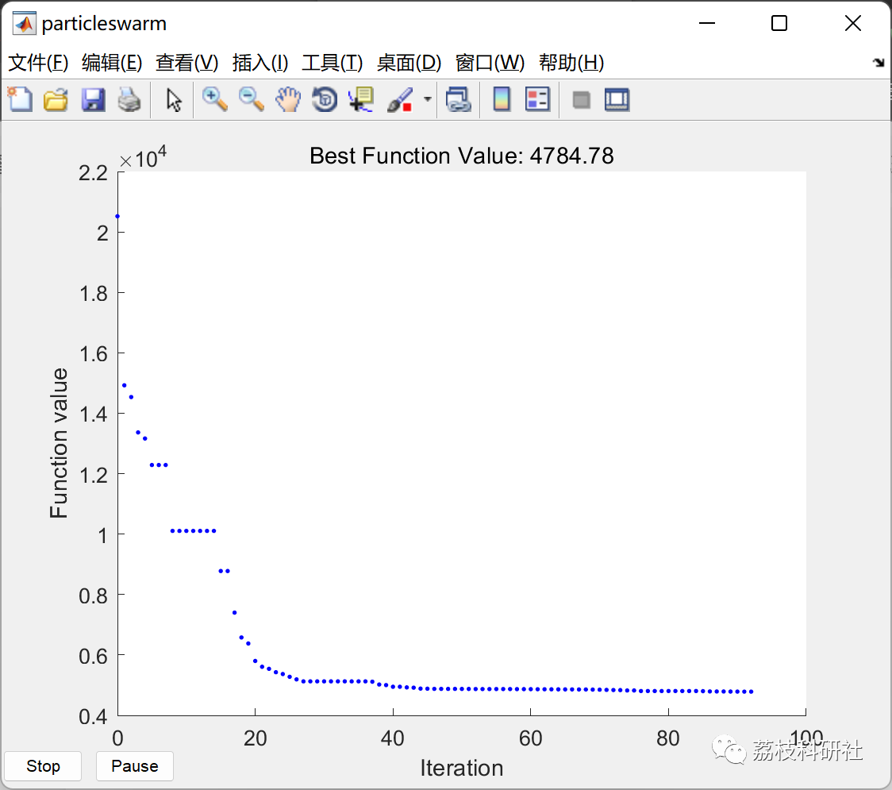
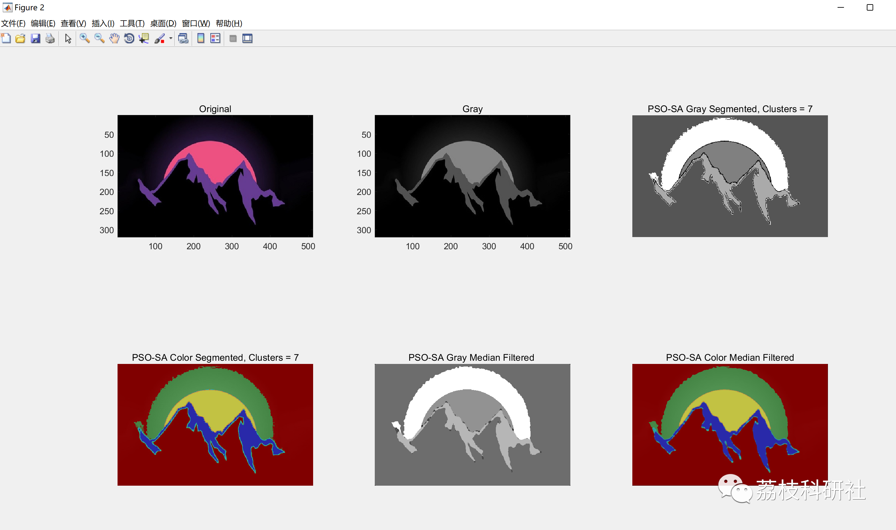
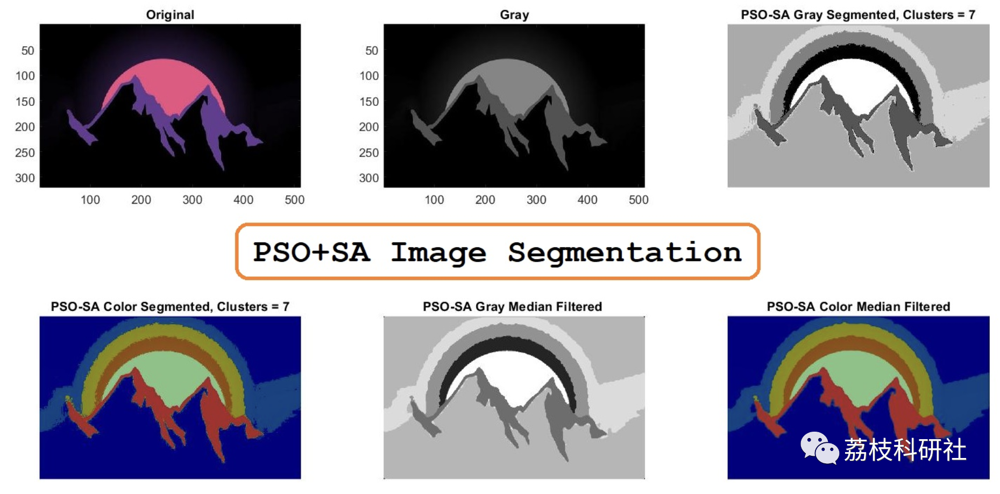

# Enhancement of Traditional Clustering Research Based on Particle Swarm Optimization and Simulated Annealing Algorithm (Matlab Code Implementation)

💥💥💞💞 Welcome to this blog❤️❤️ 💥💥
🏆 Bloggers' Advantages: 🌞🌞🌞 The content of the blog strives for rigorous thinking and clear logic to facilitate readers.
⛳️ Mantra: A journey of a thousand miles is begun with a single step.
Litchi Research Society
Code Collection: Electric power systems, intelligent algorithms and applications, neural network prediction, path planning, optimization dispatching, workshop scheduling, image processing, signal processing...
🎁 Special Section Links:
🌈🌈🌈🌟🌟🌟 Electrical Code Intelligent Algorithms and Their Applications Path Planning Neural Network Prediction Optimization Dispatching Image Processing Workshop Scheduling Signal Processing Romantic Her
💥1 Overview
​
Image segmentation is the most important part of image processing, and clustering algorithms are widely used for image segmentation. To further improve the accuracy of image segmentation and address the issues of high computational cost and slow segmentation speed in traditional multi-threshold image segmentation methods. This paper uses the PSO + SA algorithm to segment images and progressively enhances traditional clustering techniques.
📚2 Running Results
🎉3 References
[1] Lin Guoyu. Review on clustering-based image segmentation [J]. Computer Knowledge and Technology, 2022, 18(26):17-18+24. DOI:10.14004/j.cnki.ckt.2022.1713.
🌈4 MATLAB Code Implementation
Click the article below left [Read Full Content]

## Images

<!-- PAYMENT_BLOCK -->

## Get this dataset

- Payment link (Stripe): [Buy now](https://buy.stripe.com/3cs8yP7sY87d0vu9AB)
- Payment QR code: 

<!-- /PAYMENT_BLOCK -->
